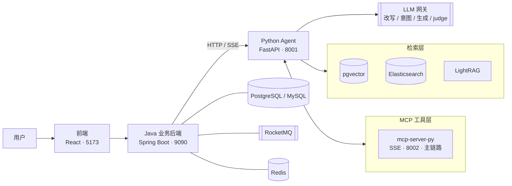

<div align="center">

# Sentinel

**AI 安全智能体平台 · 检索增强问答 × 案件调查 × 自主处置**

Java 业务后端 + Python 智能体分层架构，内置完整的 RAG 评测与 judge 校准体系


</div>

---

<div align="center">

| 登录 | 对话 | 案件调查 |
|:---:|:---:|:---:|
|  |  |  |

</div>

## 特性

- **混合检索** — pgvector + Elasticsearch 双路召回，RRF 融合 + Rerank 重排 + 双模型相关性门控（软着陆），跨语言查询改写，查询侧 embedding instruction 前缀
- **Agent 编排** — 意图树路由、会话记忆、MCP 工具调用、引用溯源、grounding 强制注入
- **案件调查（SOAR）** — 调查→报告→处置闭环，L1/L2 自动决策分级，高危动作双人复核审批，线上 override 率监控
- **评测体系** — 102 seeds e2e 回归（faithfulness / relevancy / context P&R / safety）、检索评测（Recall / MRR / HitRate）、judge 校准（Cohen's κ 门禁 + 三盲人工 golden 仲裁）、决策评测（τ-bench pass^3）、意图评测
- **分层安全** — Sa-Token 鉴权、知识库可见性控制、风险策略配置化、间接注入防护评测

## 架构



**职责边界**：Java 管业务骨架（Web 接入、鉴权、持久化、事务消息、限流、审计）；Python 管智能编排（模型调度、检索、分块、记忆、工具、评测）。业务保障能力在 Python 侧无等价物且重写引入风险，故按职责分层而非按语言重写。

## 目录结构

```
sentinel-main/
├── backend-java/     # Java 业务后端（Spring Boot）：Web 接入、鉴权、持久化、限流、审计
│   └── bootstrap/    #   主应用（9090）
├── agent-python/     # Python Agent 层（FastAPI）：编排、检索、分块、记忆、MCP、评测
│   ├── core/         #   agent / retrieval / case(SOAR) / prompt / security
│   ├── mcp-server-py/#   Python MCP Server（SSE · 8002）
│   └── eval/         #   e2e / retrieval / decision / intent 评测 + judge 校准
├── frontend/         # 前端（React 18 + Vite + Tailwind + Radix + AntV G6）
└── resources/        # MITRE ATT&CK / OWASP 等 RAG 知识库素材
```

## 快速开始

**一键启动（Windows）**：双击 [`start-sentinel.bat`](start-sentinel.bat)——按序拉起 Docker 中间件 → Python Agent → Java 后端 → MCP Server → 前端，并自动检查四个端口存活。

<details>
<summary>手动分步启动</summary>

```bash
# 0. 中间件（Docker）
docker start postgres redis rmqnamesrv rmqbroker rocketmq-dashboard rustfs etcd milvus-standalone milvus-attu

# 1. Python Agent（8001）
cd agent-python && python -m uvicorn server:app --host 0.0.0.0 --port 8001

# 2. MCP Server（8002）
cd agent-python && python mcp-server-py/server.py --transport sse --port 8002

# 3. Java 后端（9090）
cd backend-java/bootstrap && java -jar target/bootstrap-0.0.1-SNAPSHOT.jar

# 4. 前端（5173）
cd frontend && npm install && npm run dev
```

> Python MCP Server（8002）由 `agent-python` 侧脚本独立拉起，配置见 `agent-python/.env` 的 `MCP_SSE_URL`。

</details>

**环境要求**：JDK 17 · Python 3.12 · Node.js ≥ 18 · Docker（中间件）

## 端口分配

| 服务 | 端口 | 说明 |
|---|:-:|---|
| 前端（Vite） | 5173 | 开发服务器 |
| Java 业务后端 | 9090 | 业务 API，`/api/sentinel` 上下文 |
| Python Agent（FastAPI） | **8001** | 原设计 8000，因本机 Docker/WSL 占用改 8001 |
| MCP Server（Python · SSE） | **8002** | 当前业务主链路 |

> **端口变更原则**：非冲突或显式决策，不得更换端口；任何一侧变更端口，对接侧配置必须同步对齐（Java `base-url` → Python、`mcp.url` → MCP）。

## 评测指标

全部门禁 PASS。

| 维度 | 指标 | 数值 | 门禁 |
|---|---|:-:|:-:|
| 生成质量 | Faithfulness | **0.8722** | ≥ 0.85 |
| | Answer Relevancy | 0.9776 | ≥ 0.80 |
| | Safety / 误拒率 | 100% / 0% | — |
| | TTFT P95 | 10.8 s | ≤ 30 s |
| 检索 | Recall@5 / MRR / HitRate@5 | 87.0% / 0.774 / 93.0% | 全 PASS |
| Judge 校准 | Cohen's κ / MAD | 0.7141 / 0.0332 | ≥ 0.60 / ≤ 0.08 |
| 自主决策 | pass^3 / 高危误处置 / 恶性放行 | 0.8333 / 0 / 0 | 全 PASS |
| 意图识别 | Top-1 准确率 | 93.06% | — |

自检套件：SOAR 8/8 · 风险策略 16/16 · 知识库可见性 6/6 · case 代理链路 11/11

---

<div align="center">

<sub>Sentinel · built on 102 evaluation seeds</sub>

</div>
