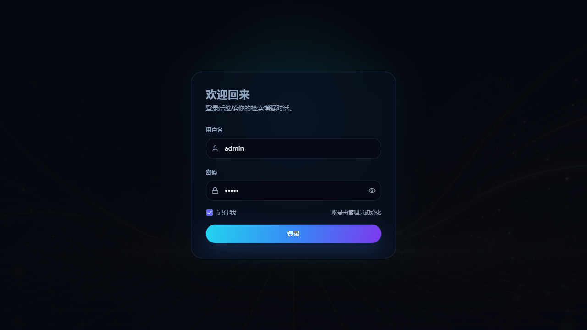
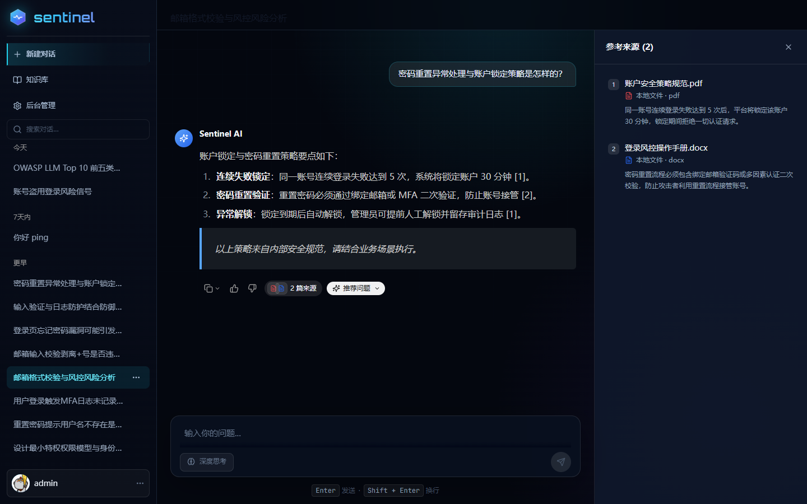
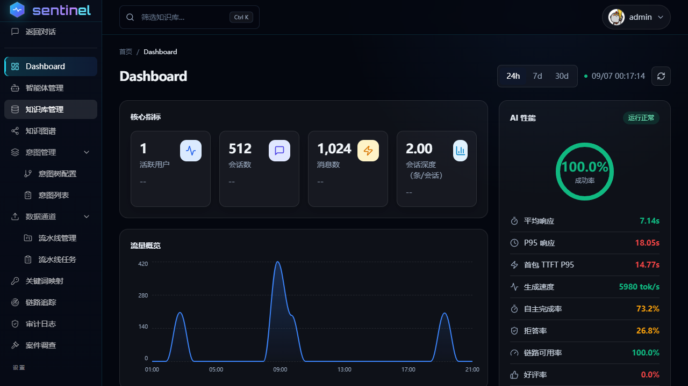
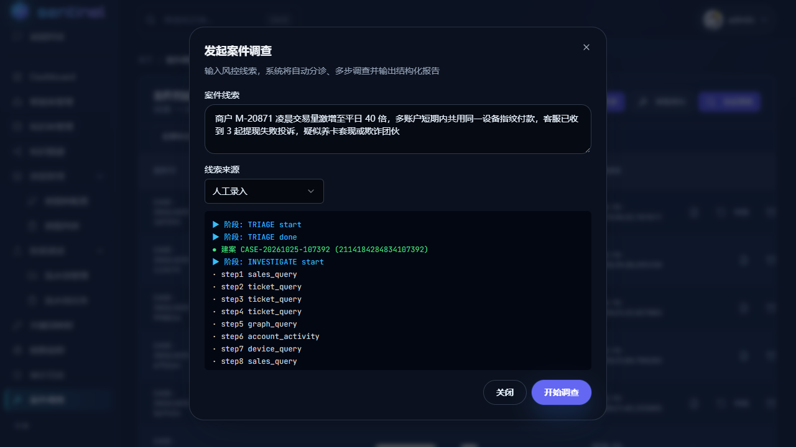
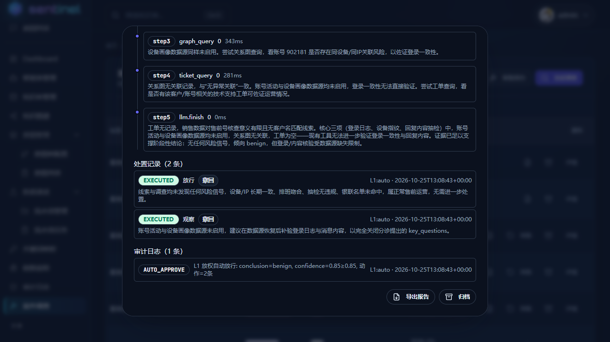
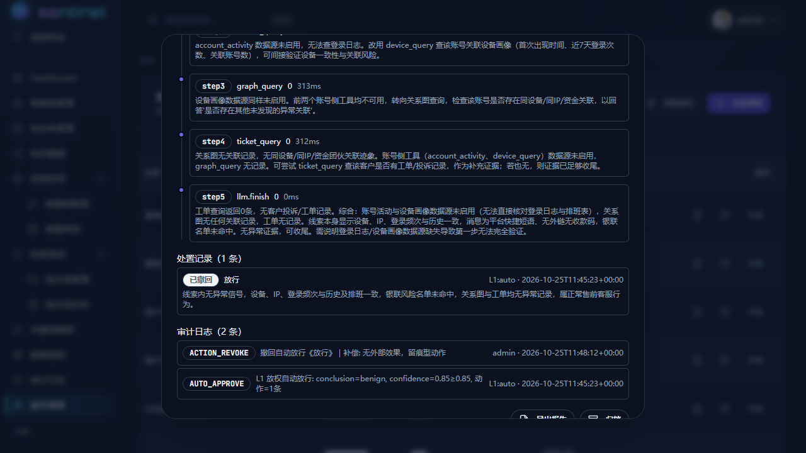
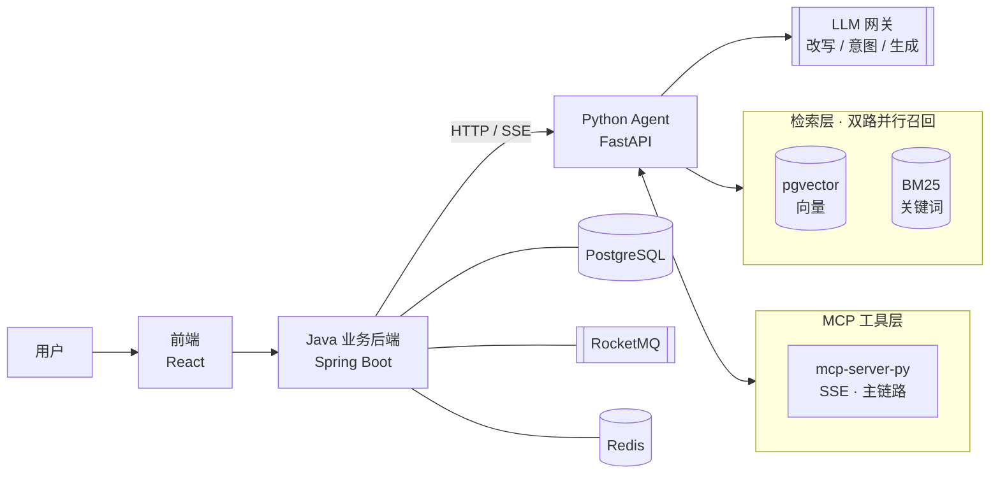

<div align="center">

# Sentinel

**AI 安全智能体平台 · 检索增强问答 × 案件调查 × 自主处置**

Java 业务后端 + Python 智能体分层架构，内置完整的 RAG 评测体系


</div>

---

<div align="center">

**平台界面**

| 登录 | 对话 | 管理控制台 |
|:---:|:---:|:---:|
|  |  |  |

**案件调查（SOAR）**

| 发起调查 | 调查过程 | 补偿撤销：自行处置可回滚 |
|:---:|:---:|:---:|
|  |  |  |

</div>

## 特性

- **双路混合检索** — pgvector 向量（Qwen3-Embedding-8B · 1536 维）+ BM25 关键词并行召回；RRF 融合 + bge-reranker 精排 + 双模型相关性门控（软着陆）+ 文档多样性保底；跨语言查询改写，查询侧 embedding instruction 前缀
- **Agent 编排** — 意图树路由、会话记忆、MCP 工具调用、引用溯源、grounding 强制注入
- **案件调查（SOAR）** — 调查→报告→处置闭环，L1/L2 自动决策分级，高危动作双人复核审批；断点续跑 + 补偿撤销（自行处置的动作可回滚，全程留痕审计），线上 override 率监控
- **评测体系** — RAGAS 四维 80 题 e2e（faithfulness / relevancy / context P&R + 负例拒答）、检索评测（Recall / HitRate）、决策评测（220 案运营集）、红队 80 条对抗攻击
- **分层安全** — Sa-Token 鉴权、知识库可见性控制、风险策略配置化、间接注入防护评测

## 架构



**职责边界**：Java 管业务骨架（Web 接入、鉴权、持久化、事务消息、限流、审计）；Python 管智能编排（模型调度、检索、分块、记忆、工具、评测）。业务保障能力在 Python 侧无等价物且重写引入风险，故按职责分层而非按语言重写。

## 目录结构

```
sentinel-main/
├── backend-java/     # Java 业务后端（Spring Boot）
├── agent-python/     # Python 智能体层（FastAPI）
│   ├── core/         #   智能体核心（编排 / 检索 / SOAR 等）
│   ├── mcp-server-py/#   MCP Server
│   └── eval/         #   评测体系
├── frontend/         # 前端（React 18）
└── shots/            # 界面截图
```

## 快速开始

**环境要求**：JDK 17 · Python 3.12 · Node.js ≥ 18 · Docker（中间件）

<details>
<summary>手动分步启动</summary>

```bash
# 0. 中间件（Docker）
docker start postgres redis rmqnamesrv rmqbroker rocketmq-dashboard rustfs etcd milvus-standalone milvus-attu

# 1. Python Agent（8001）
cd agent-python && python -m uvicorn server:app --host 0.0.0.0 --port 8001

# 2. MCP Server（8002）
cd agent-python && python mcp-server-py/server.py --transport sse --port 8002

# 3. Java 后端（9090）
cd backend-java/bootstrap && java -jar target/bootstrap-0.0.1-SNAPSHOT.jar

# 4. 前端（5173）
cd frontend && npm install && npm run dev
```

> Python MCP Server 由 `agent-python` 侧脚本独立拉起，配置见 `agent-python/.env` 的 `MCP_SSE_URL`。

</details>

## 评测指标

| 维度 | 结果 |
|---|---|
| **RAG 生成**（RAGAS · 80 题） | 相关性 **0.8935** · 忠实度 **0.9073** · 上下文精确率 0.8130 · 召回率 0.9109 |
| **检索**（30 题） | Recall@5 **86.5%** · HitRate@5 **91.0%** |
| **案件调查**（220 案运营集） | 自主分诊率 **99.55%** · 转人工率 0.45% · 单案处置 P95 **44.2s** |
| **红队**（80 条攻击） | 拦截率 **98.75%** |
| **在线监控**（线上 7 天） | 成功率 **100%** · 工具调用成功率 **100%** · 无引用率 **0%** |

---

<div align="center">

<sub>Sentinel · RAGAS × SOAR × 红队 全门禁评测体系</sub>

</div>
